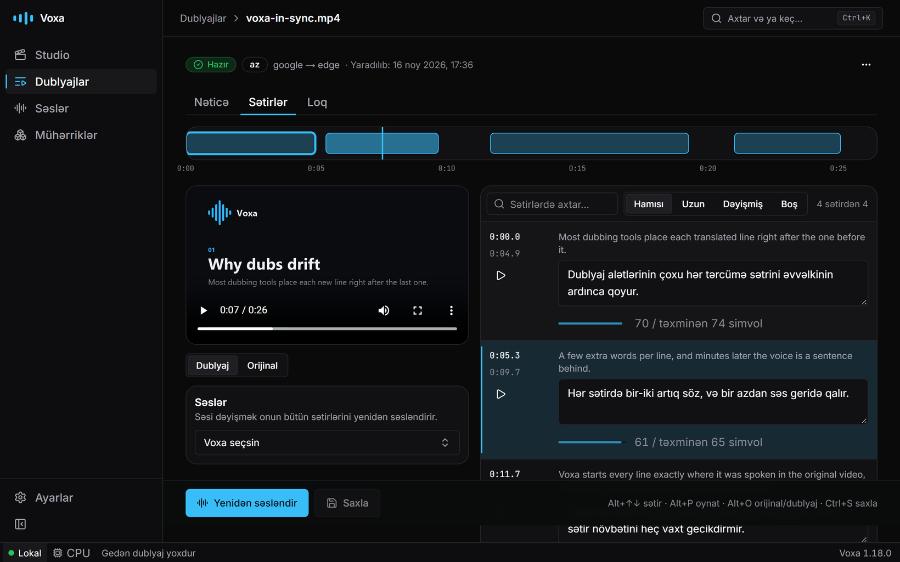

<div align="center">

# Voxa

**Videoları başqa dillərə dublyaj edir, səsi danışanla eyni vaxtda saxlayır.**

[](https://github.com/akshinmrv/Voxa/actions/workflows/ci.yml)
[](https://github.com/akshinmrv/Voxa/releases)
[](https://pypi.org/project/voxa-dub/)
[](LICENSE)
[](https://www.python.org/downloads/)

[Windows üçün yüklə](https://voxa.servoogle.com/download) ·
[macOS və Linux-da quraşdır](docs/INSTALL.md#one-line-installer) ·
[voxa.servoogle.com](https://voxa.servoogle.com/az)

</div>

Voxa videonu Whisper ilə mətnə çevirir, deyilənləri tərcümə edir, tərcüməni yeni səslə
səsləndirir və görüntünün altına geri qoyur. Hamısı öz kompüterinizdə işləyir. Standart mühərriklər
pulsuzdur, onlar üçün nə hesab, nə də API açarı lazımdır.

Voxa-nı fərqləndirən vaxtdır. Tərcümə olunmuş hər sətir orijinalda başladığı anda başlayır.
Ona görə dublyaj danışanla yalnız birinci dəqiqədə yox, otuzuncu dəqiqədə də bərabər gedir.

<p align="center">

<br>
<sub>Voxa Studio-da hazır dublyaj. Hər sətir videonun yanında, deyildiyi anın qarşısında
durur. Birini dəyişsəniz, yalnız o sətir yenidən səsləndirilir.</sub>
</p>

## Dublyaj niyə geri qalmır

Avtomatik dublyaj alətlərinin çoxu hər yeni klipi əvvəlkinin ardınca qoyur. Tərcümə olunmuş
sətir nadir hallarda orijinal qədər olur. Bir az uzun çıxan klip ondan sonra gələn hər şeyi bir
az geri itələyir və bu xəta yığılır. Üç dəqiqəlik videoda ölçdük: belə alət sonda danışandan
18 saniyə geri qalırdı.

Voxa gecikməni cəmləmir. Hər sətrə orijinalda öz başlanğıcından növbəti sətrin başlanğıcına
qədər olan vaxt verilir və sətir bu aralığın əvvəlinə qoyulur. Uzun sətir özündən sonrakı
fasiləyə keçə bilər. Yenə sığmırsa, bir az sürətli deyilir, sonra kəsilir, amma heç vaxt
növbəti sətri geri itələmir. Eyni videoda sürüşmə 0,0 saniyə olaraq qalır.

Bu qərardan daha iki şey çıxır. LLM tərcüməçiləri hər sətir üçün simvol limiti alır, ona görə
tərcümə sonradan sıxışdırılmır, əvvəldən vaxta sığan şəkildə yazılır. Nitq isə yalnız
sürətləndirilir, heç vaxt yavaşladılmır, çünki yavaşladılmış nitq süni səslənir.
Hesabın necə aparıldığını və kodda harada olduğunu [ARCHITECTURE.md](docs/ARCHITECTURE.md)
izah edir (ingiliscə).

## Quraşdırma

### Windows

[VoxaSetup.exe](https://voxa.servoogle.com/download)-ni (11 MB) yükləyib işə salın. O, Voxa
Studio-nu administrator hüququ istəmədən, yalnız sizin istifadəçiniz üçün qurur. Lazım olan
Python-u da gətirir, FFmpeg yoxdursa onu da qurur. Quraşdırma zamanı təxminən 1 GB da yükləyir,
bunun çoxu PyTorch-dur.

Quraşdırıcının hələ kod imzası yoxdur, ona görə Windows çox güman ki, xəbərdarlıq edəcək.
*More info*, sonra *Run anyway* seçin.

### macOS və Linux

```bash
curl -fsSL https://voxa.servoogle.com/install.sh | sh
```

Terminalla işləməyi sevən Windows istifadəçiləri üçün də eyni yol var:
`irm https://voxa.servoogle.com/install.ps1 | iex`.

### pipx və ya Docker ilə

Python 3.10 və ya daha yenisi və FFmpeg artıq varsa:

```bash
pipx install "voxa-dub[studio]"
```

Paketin adı `voxa-dub`, əmrin adı `voxa`-dır. Docker image-i də var:
`ghcr.io/akshinmrv/voxa`. Bütün yollar, GPU, əlavə mühərriklər və silmə qaydası
[INSTALL.md](docs/INSTALL.md)-dədir (ingiliscə).

## Voxa Studio

Studio tətbiqin özüdür. VoxaSetup onu Start menyusuna əlavə edir, başqa yerlərdə `voxa studio`
əmri açır. Windows və macOS-da öz pəncərəsində, Linux-da brauzerdə açılır.

Bir və ya bir neçə video əlavə edirsiniz, dilləri və mühərrikləri seçib başladırsınız. Dublyaj
gedərkən onun səhifəsində yeddi addım və loq görünür. Bitəndə sətirlər videonun yanında durur,
ayrılan vaxtdan uzun olanlar işarələnir. Sətri dəyişib Ctrl+S ilə saxlayın və yenidən
səsləndirin: yalnız dəyişdirdiyiniz sətirlər təzədən sintez olunur.

Bilməyə dəyər bir neçə şey:

- *İlk 20 s-ə önizləmə* yalnız videonun əvvəlini dublyaj edir. Bütün videoya vaxt sərf
  etməzdən əvvəl səsi eşidirsiniz.
- *Səsləndirmədən əvvəl tərcüməni yoxla* dublyajı sətirlər tərcümə olunan kimi dayandırır.
  Onları oxuyub düzəldirsiniz, sonra *Səsləndir* düyməsini basırsınız.
- *Səslər* səhifəsində səsi seçməzdən əvvəl dinləyə bilərsiniz. Klonlayan mühərriklər üçün öz
  qısa kliplərinizi (bir nəfərin 3-30 saniyəlik səsi) də orada saxlayırsınız.
- *Mühərriklər* səhifəsi Chatterbox, VoxCPM2 və Demucs-u bir kliklə qurur. Qurmazdan əvvəl hər
  birinin lisenziyasının nəyə icazə verdiyini göstərir.
- *Sistem* səhifəsi `voxa doctor`-un yoxlamalarını edir və çatışmayan hər şey üçün onu
  düzəldən əmri göstərir.

Pəncərənin arxasında yerli server, `voxa serve` işləyir. O, yalnız 127.0.0.1-də dinləyir və
özünüzün yazacağınız eyni `voxa` əmrini işə salır.

## Komanda sətri

Studio-nun etdiyi hər şey həm də bir əmrdir:

```bash
voxa talk.mp4 --target_lang ru                         # talk_dubbed_ru.mp4 yazır
voxa talk.mp4 --target_lang de --translator openai     # LLM tərcüməsi (OPENAI_API_KEY)
voxa talk.mp4 --target_lang tr --tts chatterbox        # danışanın səsini klonla
voxa talk.mp4 --target_lang fr --translator ollama --tts piper   # oflayn
voxa talk.mp4 --target_lang ru --preview               # yalnız ilk 20 saniyə
voxa talk.mp4 --target_lang de --review                # tərcümədən sonra dayan
voxa talk.mp4 --target_lang es --subtitles-only        # yalnız altyazı, səs yox
voxa interview.mp4 --target_lang de --diarize          # hər danışana ayrı səs
voxa doctor                                            # nə işləyir, nə çatışmır
```

Görüntü olduğu kimi köçürülür, yalnız səs yenidən qurulur. Hər addım `talk_work/` qovluğunda
saxlanır. Yarımçıq qalan iş dayandığı yerdən davam edir, ikinci dil isə hazır transkripsiyadan
istifadə edir. Qalanı [USAGE.md](docs/USAGE.md)-dədir (ingiliscə): səs seçmək, öz nitq
serverinizi qoşmaq, altyazını videoya yazmaq, orijinalın musiqisini saxlamaq, keyfiyyət
yoxlaması, konfiqurasiya və xərclər.

## Mühərriklər

| Mərhələ | Standart | Digər seçimlər |
|---|---|---|
| Transkripsiya | Whisper | faster-whisper, 2-4 dəfə sürətli |
| Tərcümə | Google | OpenAI, Anthropic, OpenRouter, Ollama (yerli) |
| Nitq | Microsoft Edge səsləri | OpenAI, Piper (oflayn), OpenAI-nin nitq API-si ilə işləyən istənilən server |
| Səs klonlama | | Chatterbox, VoxCPM2, XTTS |
| Əlavələr | | hər danışana ayrı səs (pyannote), orijinalın musiqisi (Demucs), videoda altyazı, hər sətri geri dinləyən keyfiyyət yoxlaması |

Hansı nitq mühərrikinin daha yaxşı səsləndiyi dildən asılıdır, bulud da həmişə qalib gəlmir.
Bizim ölçmələrimizdə Edge-in yerli Azərbaycan səsi OpenAI-nin səsindən xeyli yaxşı başa
düşüldü. Voxa öz nəticəsini yenidən mətnə çevirib qiymətləndirə bilir (`--quality-gate`). Belə
ki, bizim rəqəmlərə inanmaq əvəzinə mühərrikləri öz videolarınızda müqayisə edə bilərsiniz.

## Kompüterinizdən kənara nə gedir

Voxa-da hesab və telemetriya yoxdur, bizə heç nə göndərilmir. Kənara nəyin getdiyi seçdiyiniz
mühərriklərdən asılıdır:

- Transkripsiya sizin kompüterinizdə gedir.
- Hər sətrin mətni seçdiyiniz tərcüməçiyə gedir: Google, OpenAI, Anthropic və ya OpenRouter.
  Ollama yerli işləyir.
- Edge və OpenAI oxumaq üçün tərcümə olunmuş mətni alır. Piper, XTTS, Chatterbox və VoxCPM2
  yerli işləyir.
- Modellər ilk lazım olanda yüklənir.
- Studio, `voxa serve` və `voxa doctor` gündə bir dəfə PyPI-dan daha yeni Voxa olub-olmadığını
  soruşur. `VOXA_NO_UPDATE_CHECK=1` bunu söndürür.

Ollama və yerli səslə modellər diskə düşəndən sonra dublyaj üçün internet lazım deyil.

## Kommersiya istifadəsi

Voxa-nın öz kodu MIT lisenziyalıdır, məcburi asılılıqlarının heç biri GPL deyil. İstifadə
etdiyi mühərriklərin və modellərin isə öz şərtləri var, bəziləri daha sərtdir:

| Seçim | Kommersiya istifadəsi |
|---|---|
| `--translator openai` və `--tts openai` | Bəli, OpenAI-nin şərtləri ilə |
| `--tts chatterbox` (MIT) və ya `--tts voxcpm` (Apache-2.0) | Bəli |
| `--tts piper` | Səsdən asılıdır: 15 dildən 11-də icazə var |
| `--translator ollama` | Modeldən asılıdır |
| `--tts edge` və `--translator google`, standartlar | Aydın deyil: ikisi də rəsmi olmayan endpoint-lərdən istifadə edir |
| `--tts xtts` | Xeyr, çəkilər qeyri-kommersiyadır |
| `--separate` (Demucs) | Əvvəl yoxlayın: çəkilərin lisenziyası aydın deyil |

[NOTICE.md](NOTICE.md) hər səsi ayrıca izah edir (ingiliscə). Dublyaj bir məhsula girməzdən
əvvəl onu oxuyun.

## Məlum məhdudiyyətlər

- Windows quraşdırıcısının hələ kod imzası yoxdur, ona görə SmartScreen xəbərdarlıq edir.
- Voxa Studio Windows-da qurulub və yoxlanılıb. macOS pəncərəsi eyni koddandır, amma hələ heç
  kim onu Mac-də sınamayıb.
- Apple Silicon GPU-ları (`--device mps`) eksperimentaldır və ölçülməyib.
- NVIDIA GPU olmadan klonlama yavaşdır. Noutbuk prosessorunda Chatterbox bir cümləyə 40-60
  saniyə, VoxCPM2 isə iki-üç dəqiqə sərf etdi.
- `--diarize` hazır altyazıdan başlaya bilmir, çünki ona səs lazımdır.

Bunlardan biri sizə mane olursa, issue-da yazın. Növbəti işi seçməyə kömək edir.

## Töhfə vermək

Göndərə biləcəyiniz ən faydalı şey `voxa.log`-un sonu əlavə edilmiş xəta hesabatıdır. Pull
request-ləri də məmnuniyyətlə qəbul edirik. İlk pull request-ə 24 saat ərzində cavab veririk,
cavab dəyişiklik siyahısı olsa belə. [CONTRIBUTING.md](CONTRIBUTING.md) testləri, vaxt hesabını kilidləyən
golden faylları və asılılıqlar üçün iki qaydanı izah edir: məcburi asılılıqlar arasında GPL
olmur, yalnız bir mühərrikə lazım olan paket isə extra-ya gedir. Yeni nitq mühərriki bir
adapter və reyestrdə bir sətirdir, vaxt xətti və yerləşdirmə artıq hazırdır.

## Sənədlər

- [INSTALL.md](docs/INSTALL.md): bütün quraşdırma yolları, GPU, əlavə mühərriklər, Docker
- [USAGE.md](docs/USAGE.md): komanda sətri ətraflı
- [ARCHITECTURE.md](docs/ARCHITECTURE.md): pipeline və vaxt hesabı necə işləyir
- [BENCHMARK.md](docs/BENCHMARK.md): mühərrikləri öz kliplərinizdə ölçmək
- [NOTICE.md](NOTICE.md): üçüncü tərəf lisenziyaları və kommersiya istifadəsi
- [CHANGELOG.md](CHANGELOG.md)

Bu sənədlər ingiliscədir.

## Təşəkkürlər

Voxa başqalarının əməyi üzərində qurulub: transkripsiya üçün
[Whisper](https://github.com/openai/whisper) və
[faster-whisper](https://github.com/SYSTRAN/faster-whisper); nitq üçün
[edge-tts](https://github.com/rany2/edge-tts), [Piper](https://github.com/OHF-Voice/piper1-gpl),
[coqui-tts](https://github.com/idiap/coqui-ai-TTS), [Chatterbox](https://github.com/resemble-ai/chatterbox)
və [VoxCPM](https://github.com/OpenBMB/VoxCPM); səsi ayırmaq üçün
[Demucs](https://github.com/adefossez/demucs); danışanları ayırd etmək üçün
[pyannote](https://github.com/pyannote/pyannote-audio); səs və videoda hər şey üçün
[FFmpeg](https://ffmpeg.org/); quraşdırıcı və tətbiq pəncərəsi üçün
[uv](https://github.com/astral-sh/uv) və [pywebview](https://github.com/r0x0r/pywebview).

## Voxa-nı kim hazırlayır

Voxa-nı Bakıdakı rəqəmsal mühəndislik agentliyi Servoogle-da
[Akşin Miranov](https://github.com/akshinmrv) hazırlayır və dəstəkləyir. Ona müştəri işlərimizdəki
qaydanı tətbiq edirik: iddia sənədə yalnız ölçüləndən sonra düşür. Yuxarıdakı sürüşmə rəqəmi,
mühərriklərin vaxtları və lisenziya cədvəli öz ölçmələrimizdəndir. Nəyisə ölçməmişiksə, mətn
bunu açıq deyir.

Voxa MIT lisenziyalıdır, çünki dublyajı sinxron saxlamaq hər dublyaj alətinin işidir və bu
hissə bir məhsulun içində bağlı qalmamalıdır. Voxa-nı öz məhsulunuzda istifadə etmək istəsəniz,
bizi [servoogle.com](https://servoogle.com)-da tapa bilərsiniz.

<div align="center">

---

[English](README.md) · [Türkçe](README.tr.md)

</div>
