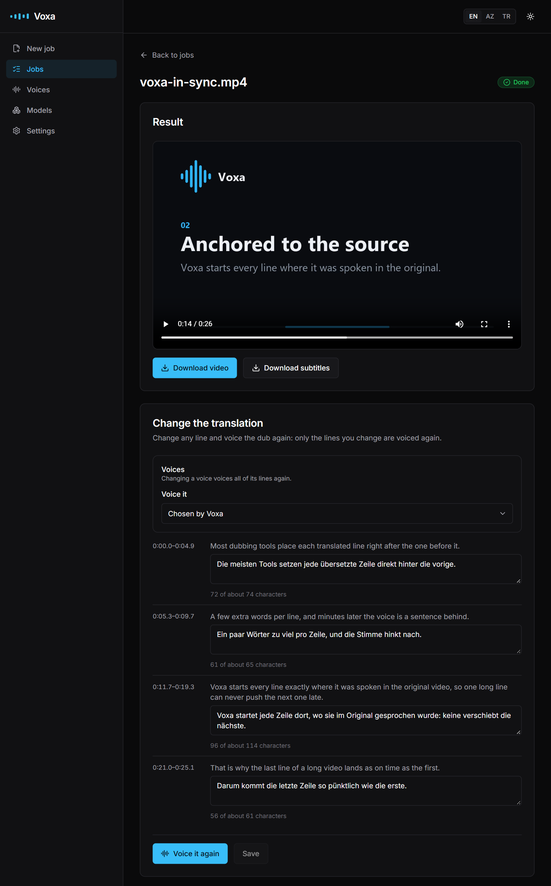

<div align="center">

# Voxa

**Dub videos into other languages, in sync with the speaker.**

[](https://github.com/akshinmrv/Voxa/actions/workflows/ci.yml)
[](https://github.com/akshinmrv/Voxa/releases)
[](https://pypi.org/project/voxa-dub/)
[](https://github.com/akshinmrv/Voxa/blob/main/LICENSE)
[](https://www.python.org/downloads/)

[Download for Windows](https://voxa.servoogle.com/download) ·
[Install on macOS or Linux](https://github.com/akshinmrv/Voxa/blob/main/docs/INSTALL.md#one-line-installer) ·
[voxa.servoogle.com](https://voxa.servoogle.com)

</div>

Voxa transcribes a video with Whisper, translates what was said, speaks the translation in a
new voice and mixes it back under the picture. It runs on your own computer, and the default
engines are free and need neither an account nor an API key.

What it does differently is timing. Every translated line starts where the original line
started, so the dub is still with the speaker in the thirtieth minute, not only the first.

<p align="center">

<br>
<sub>A finished dub in Voxa Studio. Each line sits next to the video at the moment it was
spoken; change one and only that line is voiced again.</sub>
</p>

## Why the dub stays in sync

Most automatic dubbing places each new clip right after the one before it. A translated line
is rarely as long as the original, so a clip that runs a little long pushes everything after it
a little later, and the error adds up. On a three-minute clip we measured that approach ending
18 seconds behind the speaker.

Voxa keeps no running total. Each line gets the time from its own start in the original to the
start of the next line, and it is placed at the beginning of that slot. A long line can use the
pause after it. If it still doesn't fit, it's spoken faster and then trimmed, but it can never
push the next line later. On the same clip, the drift stays at 0.0 seconds.

Two smaller choices follow from this. The LLM translators get a character budget for each line,
so the translation is written to fit instead of being squeezed afterwards. And speech is only
ever sped up, never slowed down, because slowed speech sounds dragged.
[ARCHITECTURE.md](https://github.com/akshinmrv/Voxa/blob/main/docs/ARCHITECTURE.md) walks through the arithmetic and where it lives in the
code.

## Install

### Windows

Download [VoxaSetup.exe](https://voxa.servoogle.com/download) (11 MB) and run it. It installs
Voxa Studio for your user, without administrator rights, along with the Python it needs, and
FFmpeg if you don't have it. Setup downloads about 1 GB more, mostly PyTorch.

The installer isn't code-signed yet, so Windows will probably warn you about it. Choose *More
info*, then *Run anyway*.

### macOS and Linux

```bash
curl -fsSL https://voxa.servoogle.com/install.sh | sh
```

The same thing exists for Windows users who prefer a terminal:
`irm https://voxa.servoogle.com/install.ps1 | iex`.

### With pipx or Docker

If you already have Python 3.10 or newer and FFmpeg:

```bash
pipx install "voxa-dub[studio]"
```

The package is called `voxa-dub`; the command is `voxa`. There is also a Docker image,
`ghcr.io/akshinmrv/voxa`. [INSTALL.md](https://github.com/akshinmrv/Voxa/blob/main/docs/INSTALL.md) covers every route, GPUs, the optional
engines and uninstalling.

## Voxa Studio

Studio is the app. VoxaSetup adds it to the Start menu; anywhere else, `voxa studio` starts it.
It opens in a window of its own on Windows and macOS, and in your browser on Linux.

You add one or more videos, choose the languages and engines, and start. While a dub runs, its
page shows the seven steps and the log. When it's done, the lines sit next to the video, each
marked if it's longer than the time it has. Edit a line, save with Ctrl+S and voice it again;
only the lines you changed are synthesized.

Some things worth knowing about:

- *Preview the first 20 s* dubs only the start, so you can hear the voice before you spend time
  on the whole video.
- *Check the translation before it's voiced* stops a dub once the lines are translated. You read
  and fix them, then press *Voice it*.
- The Voices page plays a voice before you pick it, and keeps short clips of your own (3 to 30
  seconds of one person) for the cloning engines.
- The Engines page installs Chatterbox, VoxCPM2 and Demucs with one click, and says what each
  licence allows before you install it.
- The System page runs the same checks as `voxa doctor` and shows the command that fixes
  anything missing.

Behind the window is a local server, `voxa serve`, which listens on 127.0.0.1 only and runs the
same `voxa` command you would type yourself.

## The command line

Everything Studio does is also a command:

```bash
voxa talk.mp4 --target_lang ru                         # writes talk_dubbed_ru.mp4
voxa talk.mp4 --target_lang de --translator openai     # LLM translation (OPENAI_API_KEY)
voxa talk.mp4 --target_lang tr --tts chatterbox        # clone the speaker's voice
voxa talk.mp4 --target_lang fr --translator ollama --tts piper   # offline
voxa talk.mp4 --target_lang ru --preview               # the first 20 seconds
voxa talk.mp4 --target_lang de --review                # stop after translating
voxa talk.mp4 --target_lang es --subtitles-only        # subtitles, no voice
voxa interview.mp4 --target_lang de --diarize          # a voice for each speaker
voxa doctor                                            # what works and what's missing
```

The video itself is copied as it is; only the sound track is rebuilt. Every step is saved in
`talk_work/`, so an interrupted run carries on where it stopped and a second language reuses the
transcription. [USAGE.md](https://github.com/akshinmrv/Voxa/blob/main/docs/USAGE.md) covers the rest: choosing voices, running your own
speech server, subtitles in the video, keeping the original's music, the quality gate,
configuration and costs.

## Engines

| Stage | Default | Other options |
|---|---|---|
| Transcription | Whisper | faster-whisper, 2 to 4 times quicker |
| Translation | Google | OpenAI, Anthropic, OpenRouter, Ollama (local) |
| Speech | Microsoft Edge voices | OpenAI, Piper (offline), any server with OpenAI's speech API |
| Voice cloning | | Chatterbox, VoxCPM2, XTTS |
| Extras | | a voice per speaker (pyannote), the original's music kept (Demucs), subtitles in the video, a quality gate that listens back to every line |

Which speech engine sounds best depends on the language, and the cloud doesn't always win. In
our runs Edge's native Azerbaijani voice was understood far better than OpenAI's. Voxa can
transcribe its own output and score it (`--quality-gate`), so you can compare engines on your
own videos instead of trusting ours.

## What leaves your computer

Voxa has no account and no telemetry, and it never sends anything to us. What does go out
depends on the engines you choose:

- Transcription runs on your machine.
- The text of each line goes to your translator: Google, OpenAI, Anthropic or OpenRouter.
  Ollama runs locally.
- Edge and OpenAI receive the translated text to speak it. Piper, XTTS, Chatterbox and VoxCPM2
  run locally.
- Models are downloaded the first time they are needed.
- Studio, `voxa serve` and `voxa doctor` ask PyPI once a day whether a newer Voxa exists.
  `VOXA_NO_UPDATE_CHECK=1` turns that off.

With Ollama and a local voice, a dub needs no network once the models are on disk.

## Commercial use

Voxa's own code is MIT, and none of its required dependencies is GPL. The engines and models it
drives have terms of their own, and some are stricter:

| Setup | Commercial use |
|---|---|
| `--translator openai` with `--tts openai` | Yes, under OpenAI's terms |
| `--tts chatterbox` (MIT) or `--tts voxcpm` (Apache-2.0) | Yes |
| `--tts piper` | Depends on the voice: 11 of the 15 languages allow it |
| `--translator ollama` | Depends on the model |
| `--tts edge` and `--translator google`, the defaults | Unclear: both use unofficial endpoints |
| `--tts xtts` | No, the weights are non-commercial |
| `--separate` (Demucs) | Check first: the licence of the weights is unclear |

[NOTICE.md](https://github.com/akshinmrv/Voxa/blob/main/NOTICE.md) goes through it voice by voice. Read it before a dub goes into a product.

## Known limits

- The Windows installer isn't code-signed yet, so SmartScreen warns about it.
- Voxa Studio is built and tested on Windows. The macOS window comes from the same code, but
  nobody has tried it on a Mac yet.
- Apple Silicon GPUs (`--device mps`) are experimental and haven't been measured.
- Cloning is slow without an NVIDIA GPU. On a laptop CPU, Chatterbox took 40 to 60 seconds per
  sentence and VoxCPM2 two to three minutes.
- `--diarize` can't start from existing subtitles, since it needs the audio.

If one of these is in your way, say so in an issue. It helps decide what to work on next.

## Contributing

The most useful thing you can send is a bug report with the end of `voxa.log` attached. Pull
requests are welcome, and a first one gets an answer within 24 hours, even if the answer is a
list of changes. [CONTRIBUTING.md](https://github.com/akshinmrv/Voxa/blob/main/CONTRIBUTING.md) explains the test suite, the golden files
that lock the timing arithmetic, and the two rules for dependencies: nothing GPL among the
required ones, and anything only one engine needs goes in an extra. A new speech engine is one
adapter and one line in a registry; the timeline and placement are already taken care of.

## Documentation

- [INSTALL.md](https://github.com/akshinmrv/Voxa/blob/main/docs/INSTALL.md): every way to install, GPUs, optional engines, Docker
- [USAGE.md](https://github.com/akshinmrv/Voxa/blob/main/docs/USAGE.md): the command line in detail
- [ARCHITECTURE.md](https://github.com/akshinmrv/Voxa/blob/main/docs/ARCHITECTURE.md): how the pipeline and the timing work
- [BENCHMARK.md](https://github.com/akshinmrv/Voxa/blob/main/docs/BENCHMARK.md): measuring engines on your own clips
- [NOTICE.md](https://github.com/akshinmrv/Voxa/blob/main/NOTICE.md): third-party licences and commercial use
- [CHANGELOG.md](https://github.com/akshinmrv/Voxa/blob/main/CHANGELOG.md)

## Credits

Voxa is built on other people's work: [Whisper](https://github.com/openai/whisper) and
[faster-whisper](https://github.com/SYSTRAN/faster-whisper) for transcription;
[edge-tts](https://github.com/rany2/edge-tts), [Piper](https://github.com/OHF-Voice/piper1-gpl),
[coqui-tts](https://github.com/idiap/coqui-ai-TTS), [Chatterbox](https://github.com/resemble-ai/chatterbox)
and [VoxCPM](https://github.com/OpenBMB/VoxCPM) for speech; [Demucs](https://github.com/adefossez/demucs)
for separation; [pyannote](https://github.com/pyannote/pyannote-audio) for telling speakers
apart; [FFmpeg](https://ffmpeg.org/) for everything audio and video; and
[uv](https://github.com/astral-sh/uv) and [pywebview](https://github.com/r0x0r/pywebview) for the
installer and the app window.

## Who makes Voxa

Voxa is written and maintained by [Akshin Miranov](https://github.com/akshinmrv) at Servoogle,
a digital engineering agency in Baku. We hold it to the same rule as our client work: a claim
goes into the documentation once we have measured it. The drift figure, the engine timings and
the licence table above come from our own runs, and where something hasn't been measured, the
text says so.

Voxa is MIT-licensed because every dubbing tool has to keep a dub in sync, and that part
shouldn't be locked inside a product. If you need Voxa inside yours,
[servoogle.com](https://servoogle.com) is where to find us.

<div align="center">

---

[Azərbaycanca](https://github.com/akshinmrv/Voxa/blob/main/README.az.md) · [Türkçe](https://github.com/akshinmrv/Voxa/blob/main/README.tr.md)

</div>
