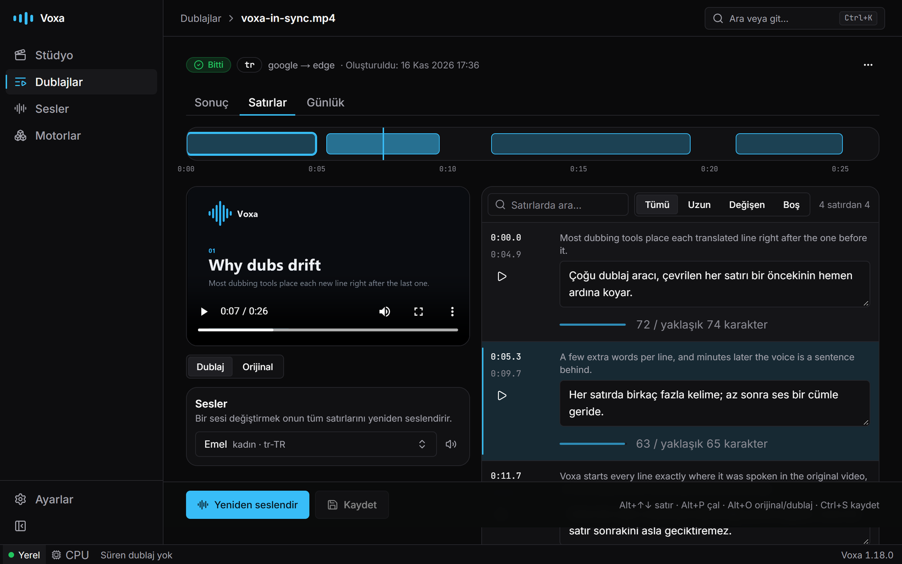

<div align="center">

# Voxa

**Videoları başka dillere dublajlar, sesi konuşanla aynı zamanda tutar.**

[](https://github.com/akshinmrv/Voxa/actions/workflows/ci.yml)
[](https://github.com/akshinmrv/Voxa/releases)
[](https://pypi.org/project/voxa-dub/)
[](LICENSE)
[](https://www.python.org/downloads/)

[Windows için indir](https://voxa.servoogle.com/download) ·
[macOS ve Linux'ta kur](docs/INSTALL.md#one-line-installer) ·
[voxa.servoogle.com](https://voxa.servoogle.com/tr)

</div>

Voxa bir videoyu Whisper ile yazıya döker, söyleneni çevirir, çeviriyi yeni bir sesle
seslendirir ve görüntünün altına geri yerleştirir. Hepsi kendi bilgisayarınızda çalışır.
Varsayılan motorlar ücretsizdir; hesap da API anahtarı da gerekmez.

Voxa'yı farklı kılan zamanlamadır. Çevrilen her satır, orijinalde başladığı anda başlar. Bu
yüzden dublaj konuşanla yalnızca ilk dakikada değil, otuzuncu dakikada da aynı yerdedir.

<p align="center">

<br>
<sub>Voxa Studio'da bitmiş bir dublaj. Her satır videonun yanında, söylendiği anın hizasında
durur. Birini değiştirirseniz yalnızca o satır yeniden seslendirilir.</sub>
</p>

## Dublaj neden kaymıyor

Otomatik dublaj araçlarının çoğu her yeni klibi bir öncekinin hemen arkasına koyar. Çevrilen
satır nadiren orijinali kadar sürer. Biraz uzun çıkan bir klip kendisinden sonraki her şeyi biraz
geriye iter ve hata birikir. Üç dakikalık bir videoda ölçtük: bu yöntem sonunda konuşanın 18
saniye gerisinde kalıyordu.

Voxa gecikmeyi toplamaz. Her satıra, orijinalde kendi başlangıcından bir sonraki satırın
başlangıcına kadar olan süre verilir ve satır bu aralığın başına yerleştirilir. Uzun bir satır
arkasındaki duraksamayı kullanabilir. Yine sığmazsa biraz hızlı söylenir, sonra kırpılır; ama
bir sonraki satırı asla geriye itmez. Aynı videoda kayma 0,0 saniyede kalır.

Bu karardan iki şey daha çıkar. LLM çevirmenleri her satır için bir karakter bütçesi alır, böylece
çeviri sonradan sıkıştırılmaz, en baştan süreye sığacak şekilde yazılır. Konuşma da yalnızca
hızlandırılır, asla yavaşlatılmaz, çünkü yavaşlatılmış konuşma yapay duyulur. Hesabın nasıl
yapıldığını ve kodda nerede durduğunu [ARCHITECTURE.md](docs/ARCHITECTURE.md) anlatıyor
(İngilizce).

## Kurulum

### Windows

[VoxaSetup.exe](https://voxa.servoogle.com/download)'yi (11 MB) indirip çalıştırın. Voxa
Studio'yu yönetici hakkı istemeden, yalnızca sizin kullanıcınız için kurar. Gereken Python'u
da getirir, FFmpeg yoksa onu da kurar. Kurulum sırasında yaklaşık 1 GB daha indirir, çoğu
PyTorch'tur.

Kurulum aracının henüz kod imzası yok, bu yüzden Windows büyük olasılıkla uyarı verecek.
*Ek bilgi*'yi, ardından *Yine de çalıştır*'ı seçin.

### macOS ve Linux

```bash
curl -fsSL https://voxa.servoogle.com/install.sh | sh
```

Terminali tercih eden Windows kullanıcıları için de aynısı var:
`irm https://voxa.servoogle.com/install.ps1 | iex`.

### pipx ya da Docker ile

Python 3.10 veya daha yenisi ve FFmpeg zaten kuruluysa:

```bash
pipx install "voxa-dub[studio]"
```

Paketin adı `voxa-dub`, komutun adı `voxa`. Bir Docker imajı da var:
`ghcr.io/akshinmrv/voxa`. Tüm kurulum yolları, GPU, ek motorlar ve kaldırma
[INSTALL.md](docs/INSTALL.md)'de (İngilizce).

## Voxa Studio

Studio uygulamanın kendisidir. VoxaSetup onu Başlat menüsüne ekler; başka yerlerde
`voxa studio` komutu açar. Windows ve macOS'ta kendi penceresinde, Linux'ta tarayıcıda açılır.

Bir veya birkaç video eklersiniz, dilleri ve motorları seçip başlatırsınız. Dublaj sürerken
sayfasında yedi adım ve günlük görünür. Bittiğinde satırlar videonun yanında durur, kendine
ayrılan süreden uzun olanlar işaretlenir. Bir satırı değiştirin, Ctrl+S ile kaydedin ve yeniden
seslendirin: yalnızca değiştirdiğiniz satırlar baştan sentezlenir.

Bilmeye değer birkaç şey:

- *İlk 20 sn'yi önizle* yalnızca videonun başını dublajlar. Bütün videoya zaman harcamadan
  önce sesi duyarsınız.
- *Seslendirmeden önce çeviriyi kontrol et* dublajı satırlar çevrilir çevrilmez durdurur.
  Satırları okuyup düzeltirsiniz, sonra *Seslendir*'e basarsınız.
- *Sesler* sayfasında bir sesi seçmeden önce dinleyebilirsiniz. Ses klonlayan motorlar için
  kendi kısa kayıtlarınızı (tek kişinin 3-30 saniyelik sesi) da orada tutarsınız.
- *Motorlar* sayfası Chatterbox, VoxCPM2 ve Demucs'u tek tıkla kurar. Kurmadan önce her birinin
  lisansının neye izin verdiğini gösterir.
- *Sistem* sayfası `voxa doctor`'ın denetimlerini yapar ve eksik olan her şey için onu
  düzelten komutu gösterir.

Pencerenin arkasında yerel bir sunucu, `voxa serve` çalışır. Yalnızca 127.0.0.1'de dinler ve
sizin elle yazacağınız `voxa` komutunun aynısını çalıştırır.

## Komut satırı

Studio'nun yaptığı her şey aynı zamanda bir komuttur:

```bash
voxa talk.mp4 --target_lang ru                         # talk_dubbed_ru.mp4 yazar
voxa talk.mp4 --target_lang de --translator openai     # LLM çevirisi (OPENAI_API_KEY)
voxa talk.mp4 --target_lang tr --tts chatterbox        # konuşanın sesini klonla
voxa talk.mp4 --target_lang fr --translator ollama --tts piper   # çevrimdışı
voxa talk.mp4 --target_lang ru --preview               # yalnızca ilk 20 saniye
voxa talk.mp4 --target_lang de --review                # çeviriden sonra dur
voxa talk.mp4 --target_lang es --subtitles-only        # yalnızca altyazı, ses yok
voxa interview.mp4 --target_lang de --diarize          # her konuşana ayrı ses
voxa doctor                                            # ne çalışıyor, ne eksik
```

Görüntü olduğu gibi kopyalanır, yalnızca ses yeniden kurulur. Her adım `talk_work/` klasörüne
kaydedilir. Yarıda kalan bir iş kaldığı yerden devam eder, ikinci dil de hazır yazıya dökümü
kullanır. Gerisi [USAGE.md](docs/USAGE.md)'de (İngilizce): ses seçmek, kendi konuşma
sunucunuzu bağlamak, altyazıyı videoya eklemek, orijinalin müziğini korumak, kalite denetimi,
yapılandırma ve maliyetler.

## Motorlar

| Aşama | Varsayılan | Diğer seçenekler |
|---|---|---|
| Yazıya dökme | Whisper | faster-whisper, 2-4 kat hızlı |
| Çeviri | Google | OpenAI, Anthropic, OpenRouter, Ollama (yerel) |
| Konuşma | Microsoft Edge sesleri | OpenAI, Piper (çevrimdışı), OpenAI'nin konuşma API'sini sunan her sunucu |
| Ses klonlama | | Chatterbox, VoxCPM2, XTTS |
| Ekler | | her konuşana ayrı ses (pyannote), orijinalin müziği (Demucs), videoda altyazı, her satırı geri dinleyen kalite denetimi |

Hangi konuşma motorunun daha iyi duyulduğu dile göre değişir ve bulut her zaman kazanmaz.
Ölçümlerimizde Edge'in yerel Azerbaycanca sesi, OpenAI'ninkinden çok daha iyi anlaşıldı. Voxa
kendi çıktısını yeniden yazıya döküp puanlayabilir (`--quality-gate`); böylece bizim
rakamlarımıza güvenmek yerine motorları kendi videolarınızda karşılaştırabilirsiniz.

## Bilgisayarınızdan dışarı ne çıkar

Voxa'da hesap ve telemetri yok, bize hiçbir şey gönderilmez. Dışarı neyin gittiği seçtiğiniz
motorlara bağlıdır:

- Yazıya dökme kendi bilgisayarınızda yapılır.
- Her satırın metni seçtiğiniz çevirmene gider: Google, OpenAI, Anthropic ya da OpenRouter.
  Ollama yerelde çalışır.
- Edge ve OpenAI, seslendirmek için çevrilmiş metni alır. Piper, XTTS, Chatterbox ve VoxCPM2
  yerelde çalışır.
- Modeller ilk gerektiklerinde indirilir.
- Studio, `voxa serve` ve `voxa doctor` günde bir kez PyPI'a daha yeni bir Voxa olup olmadığını
  sorar. `VOXA_NO_UPDATE_CHECK=1` bunu kapatır.

Ollama ve yerel bir sesle, modeller diske indikten sonra dublaj için internet gerekmez.

## Ticari kullanım

Voxa'nın kendi kodu MIT lisanslıdır ve zorunlu bağımlılıklarının hiçbiri GPL değildir.
Kullandığı motorların ve modellerin ise kendi koşulları var, bazıları daha katıdır:

| Seçim | Ticari kullanım |
|---|---|
| `--translator openai` ile `--tts openai` | Evet, OpenAI'nin koşullarıyla |
| `--tts chatterbox` (MIT) ya da `--tts voxcpm` (Apache-2.0) | Evet |
| `--tts piper` | Sese bağlı: 15 dilin 11'inde izin var |
| `--translator ollama` | Modele bağlı |
| `--tts edge` ve `--translator google`, varsayılanlar | Belirsiz: ikisi de resmî olmayan uç noktalar kullanır |
| `--tts xtts` | Hayır, ağırlıklar ticari olmayan kullanım içindir |
| `--separate` (Demucs) | Önce kontrol edin: ağırlıkların lisansı belirsiz |

[NOTICE.md](NOTICE.md) her sesi tek tek ele alıyor (İngilizce). Bir dublaj bir ürüne girmeden
önce okuyun.

## Bilinen sınırlar

- Windows kurulum aracının henüz kod imzası yok, bu yüzden SmartScreen uyarı veriyor.
- Voxa Studio Windows'ta geliştirildi ve denendi. macOS penceresi aynı koddan geliyor ama henüz
  kimse onu bir Mac'te denemedi.
- Apple Silicon GPU'ları (`--device mps`) deneyseldir ve ölçülmedi.
- NVIDIA GPU olmadan klonlama yavaştır. Bir dizüstü işlemcide Chatterbox cümle başına 40-60
  saniye, VoxCPM2 ise iki-üç dakika harcadı.
- `--diarize` hazır altyazıdan başlayamaz, çünkü sese ihtiyacı vardır.

Bunlardan biri işinizi engelliyorsa bir issue'da yazın. Sırada ne üzerinde çalışılacağına karar
vermeye yardımcı olur.

## Katkıda bulunmak

Gönderebileceğiniz en faydalı şey, `voxa.log`'un son satırlarını eklediğiniz bir hata
raporudur. Pull request'leri de memnuniyetle karşılıyoruz. İlk pull request'e 24 saat içinde
yanıt veriyoruz, yanıt bir değişiklik listesi olsa bile. [CONTRIBUTING.md](CONTRIBUTING.md)
testleri, zamanlama hesabını kilitleyen golden dosyaları ve bağımlılıklar için iki kuralı
anlatıyor: zorunlu bağımlılıklar arasında GPL olmaz, yalnızca bir motorun ihtiyaç duyduğu paket
de bir extra'ya gider. Yeni bir konuşma motoru, bir adaptör ve kayıt defterinde bir satırdan
ibarettir; zaman çizelgesi ve yerleştirme zaten hazırdır.

## Belgeler

- [INSTALL.md](docs/INSTALL.md): tüm kurulum yolları, GPU, ek motorlar, Docker
- [USAGE.md](docs/USAGE.md): komut satırı ayrıntılı
- [ARCHITECTURE.md](docs/ARCHITECTURE.md): işlem hattı ve zamanlama nasıl çalışıyor
- [BENCHMARK.md](docs/BENCHMARK.md): motorları kendi kliplerinizde ölçmek
- [NOTICE.md](NOTICE.md): üçüncü taraf lisansları ve ticari kullanım
- [CHANGELOG.md](CHANGELOG.md)

Bu belgeler İngilizcedir.

## Teşekkürler

Voxa başkalarının emeği üzerine kurulu: yazıya dökme için
[Whisper](https://github.com/openai/whisper) ve
[faster-whisper](https://github.com/SYSTRAN/faster-whisper); konuşma için
[edge-tts](https://github.com/rany2/edge-tts), [Piper](https://github.com/OHF-Voice/piper1-gpl),
[coqui-tts](https://github.com/idiap/coqui-ai-TTS), [Chatterbox](https://github.com/resemble-ai/chatterbox)
ve [VoxCPM](https://github.com/OpenBMB/VoxCPM); sesi ayırmak için
[Demucs](https://github.com/adefossez/demucs); konuşanları ayırt etmek için
[pyannote](https://github.com/pyannote/pyannote-audio); ses ve görüntüyle ilgili her şey için
[FFmpeg](https://ffmpeg.org/); kurulum aracı ve uygulama penceresi için
[uv](https://github.com/astral-sh/uv) ve [pywebview](https://github.com/r0x0r/pywebview).

## Voxa'yı kim yapıyor

Voxa'yı Bakü'deki dijital mühendislik ajansı Servoogle'da
[Akşin Miranov](https://github.com/akshinmrv) geliştiriyor ve sürdürüyor. Ona müşteri
işlerimizdeki kuralı uyguluyoruz: bir iddia belgelere ancak ölçüldükten sonra girer. Yukarıdaki
kayma rakamı, motor süreleri ve lisans tablosu kendi ölçümlerimizden geliyor. Bir şeyi
ölçmediysek, metin bunu açıkça söylüyor.

Voxa MIT lisanslı, çünkü dublajı senkron tutmak her dublaj aracının işi ve bu kısım bir ürünün
içine kilitlenmemeli. Voxa'yı kendi ürününüzde kullanmak isterseniz bize
[servoogle.com](https://servoogle.com)'dan ulaşabilirsiniz.

<div align="center">

---

[English](README.md) · [Azərbaycanca](README.az.md)

</div>
